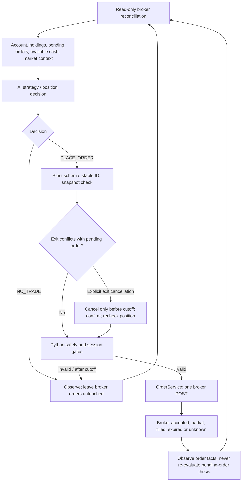

# OneShotEngine — isolated prototype

Status: **offline-only experiment**. The production `Engine`, `main.py`,
LumiBot hooks, dashboard and supervisor have **not** been switched over.
`OneShotEngine` requires a `FakeBroker`; it cannot submit a real or Alpaca
Paper order. It is deliberately not added to a CLI/autopilot entrypoint.

## Behavioral contract

1. Python supplies the model with the authoritative account snapshot:
   existing positions, open orders, filled quantities, reserved cash, allowed
   symbols, exchange session, current timestamp, recent decisions, and optional
   read-only market/research data.
2. Strategy guidance is **advisory**. The AI owns stock selection (inside the
   configured pool), trade direction, quantity, limit price and position
   actions. The model cannot change Python's order legality, account safety,
   session cutoff or idempotency guards.
3. The AI returns `OneShotDecision` (`NO_TRADE` or `PLACE_ORDER`) through a
   strict Pydantic schema. A valid order is submitted immediately through the
   existing `OrderService`, without price triggers or a second strategy check.
4. An accepted order stays with the broker. `NO_TRADE` does not cancel it.
   The read-only reconciliation loop observes acceptance, partial fills,
   completion, expiration, rejection and uncertain dispatches.
5. Any actual fill, including a partial fill, changes the position snapshot.
   A subsequent independent AI position decision can issue a new trade.
6. If an AI **position-exit** decision explicitly asks to cancel an opposing
   open entry order, Python attempts cancellation **only before the cutoff**.
   It must confirm the broker's terminal order status and verify that filled
   quantity/position did not change during cancellation before submitting the
   exit. Otherwise it refuses the exit and requires a new decision.
7. At or after `submit_cutoff` (currently 11:59:30 America/New_York) Python
   makes **no new order submissions or cancellation requests**. At and after
   12:00 it remains read-only, while previously accepted DAY orders can remain
   at Alpaca and fill or expire according to broker rules.
8. Same `decision_id` + same intent is idempotent. Reusing the ID for a
   different price/side/symbol is rejected. Identical pending orders under a
   *new* ID are blocked by default; the AI must explicitly mark a deliberately
   additional pending order.



## Current boundaries

- The test AI is injected. A minimal `ONE_SHOT_DECISION` prompt has been
  registered for potential future experiments, but no real DeepSeek request
  has been made and no real-model decision accuracy is established.
- Decision IDs are now reserved atomically in SQLite across Store connections.
  The reservation is durable even for `NO_TRADE` and precedes cancellation or
  order submission. This does not yet serialize separate decisions that target
  the same account or prove the full worker lifecycle is safe across processes.
- Before a production migration, design and test model/runtime liveness,
  watchdog and dashboard permission rules independently.
- No automatic broker cancellation at noon. There is also no automatic
  emergency closing trade after noon; any position filled later remains
  exposed according to the user's selected rule.
- The engine only runs when `cycle()` is called. A future scheduler can wake
  the AI and provide fresh data; that scheduler must not issue orders itself.
- The experiment does not show trading profitability, live API conformance,
  real-market data quality, or production availability.

## Running safely

Run the offline behavioral tests with your project's own configured Python:

```bash
python -m pytest -q tests/test_one_shot_engine.py
```

Do **not** wire `OneShotEngine` into `main.py`, `strategy.py` or
`paper_supervisor.py` merely because the offline tests pass.

## Migration against the current repository

The imported prototype has been adapted without replacing the current worker
or its uncommitted changes. The target architecture still needs these gates:

1. Add a read-only premarket research scheduler and a bounded active decision
   scheduler. Feed broker positions, pending orders, reserved cash, quote age,
   news provenance and recent decisions into each model snapshot. The existing
   `PremarketScheduler` calls the legacy `Engine`, so it is not a OneShot
   scheduler.
2. Run the strict `ONE_SHOT_DECISION` schema and registered prompt through a
   real DeepSeek **shadow** path first. Compare decisions with broker facts and
   record malformed output, latency and data staleness. The current OneShot
   tests inject a synthetic AI and do not establish real model behavior.
3. Replace the `FakeBroker` restriction only in a separately reviewed Paper
   adapter. Reuse `OrderService`, the watchdog, web heartbeat, startup
   reconciliation and existing pause/freeze controls. Serialize the complete
   decision-to-dispatch window across worker processes, including separate IDs
   that propose the same pending order.
4. Exercise restart, partial fill, uncertain POST/cancel, noon cutoff and
   next-day recovery with an isolated Paper account before selecting the new
   engine in `PaperStrategy`. Keep the production engine selector disabled
   until those checks pass; activation must not unpause the account.

The repository policy and `config/execution.yaml` now agree: active trading
ends at 12:00 ET, with the last local submission before 11:59:30 ET. This
prototype follows the loaded execution configuration in offline tests.
