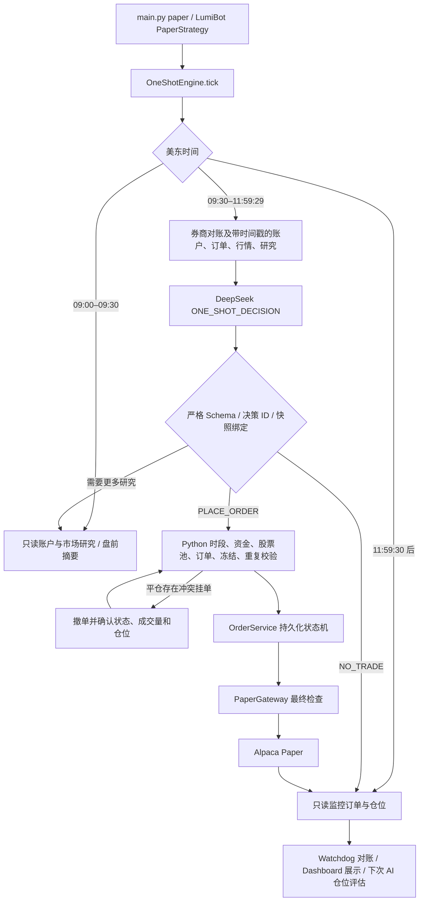

# OneShotEngine 正式主引擎迁移报告

日期：2026-11-07。范围：当前本地 Git 仓库 `alpaca-trade-bot`。本次没有启动交易 worker、没有调用 Alpaca 写接口、没有提交真实或 Paper 订单。

## 审计结论与新流程

迁移前正式入口为 `main.py paper` → LumiBot `PaperStrategy` → 旧 `Engine.tick()`；盘前由独立 `PremarketScheduler` 调用旧 `Engine.premarket_tick()`。旧引擎依赖盘前计划、Python 价格触发器、`REQUEST_AI_RECHECK` 和多智能体计划更新。`OrderService`、`PaperGateway`、SQLite 订单状态机、Watchdog、Dashboard 属于可复用基础设施。

AI 决定是否交易、标的、多空、数量、限价、等待和仓位调整。策略文字仅作为提示。Python 执行股票池、资金、限价单形状、交易时段、暂停、冻结和去重硬约束。一次决策最多提交一个 DAY 限价单；不等待 Python 价格触发。`NO_TRADE` 不撤销挂单。11:59:30 ET 起禁止新订单和主动撤单，之后已接受的 DAY 挂单继续由券商管理。

## 修改和删除清单

- **正式入口与核心**：修改 `src/trading_bot/main.py`、`strategy.py`、`one_shot_engine.py`；新增 `one_shot_scheduler.py`。正式 LumiBot 回调只调用 OneShotEngine；盘前调度只做研究。OneShotEngine 接受真实 `PaperGateway` 和离线 `FakeBroker`，接入网页心跳、配置漂移、Watchdog、重启恢复、跨进程决策锁、账户及研究上下文、冲突撤单确认。
- **下单基础设施**：保留 `execution.py`、`risk_manager.py`、`storage.py`、`watchdog.py`；修改 `broker.py` 在最终 POST 和撤单前检查截止时间。继续使用持久化的 `one_shot_decisions` 表及唯一决策 ID 预留，保留订单状态机。
- **配置、提示词与模型**：修改 `settings.py`、`config/execution.yaml`、`config/strategy.yaml`、`deepseek_client.py`、`prompts/one_shot_decision.txt`；新增 `prompts/one_shot_research.txt`。删除 `config/multi_agent.yaml` 及正式提示词目录中全部旧计划、巡检、复核和三智能体提示词。旧提示词仅在 `archive/legacy_prompts/` 供历史考试复现。
- **旧交易架构删除**：删除 `src/trading_bot/engine.py`、`premarket_scheduler.py`、`multi_agent.py`、`agent_schemas.py`、`research_only.py`。旧 `decision_schema.py` 的计划、触发器和复核类迁入 `src/exam_replay/legacy_decision_schema.py`，正式包的 `decision_schema.py` 只保留订单与研究的严格 Schema。历史考试工具改为显式引用历史模块。
- **显示与运维**：修改 `dashboard.py`、`assistant.py`、`reporting.py`、`robot_log.py`、`web/app.js`、`web/index.html`，展示 OneShot 决策、研究、订单和安全状态；移除有效旧计划价格条件面板与多智能体页面。修改 `dry_run.py`、`offline_validation.py` 为 OneShot 离线流程。
- **文档和测试**：更新 `README.md`、`AGENTS.md`；旧 `MULTI_AGENT.md` 和旧 OneShot 草案移至 `archive/legacy_docs/`。旧引擎专属测试原文移至 `archive/legacy_engine_tests/`，不再作为当前生产测试；修改其余受影响的测试和考试工具；新增 `tests/test_production_entry.py`，覆盖 LumiBot 正式回调与 PaperGateway 类型的离线接线。

## 测试与启动验证

| 验证 | 结果 |
| --- | --- |
| 全量离线 pytest | 306 passed；1 条第三方 `websockets.legacy` 弃用警告 |
| 浏览器脚本语法 | `node --check web/app.js` 通过 |
| Python 编译 | `compileall -q src tests tools` 通过 |
| 配置只读检查 | 48 个固定池标的；`active_end=12:00`，`submit_cutoff=11:59:30`；策略配置有效 |
| 正式入口替身验证 | `PaperStrategy.initialize` 构造 `OneShotEngine`，`on_trading_iteration` 调用其 `tick()`；新数据库默认暂停；无 Alpaca 写请求 |
| Paper 类型接线 | `OneShotEngine` 接受 `PaperGateway` 子类，离线替身经过 `OrderService` 和 SQLite 状态机完成一次合成订单；无网络连接 |
| 离线端到端场景 | 网络禁用、合成 POST 1 次、真实/Paper 订单 0 次、午后继续持有 DAY 挂单且自动撤单 0 次、次日对账后持仓 3 股 |
| 旧路径扫描 | 正式 `src/trading_bot`、`config`、`prompts` 中无旧 Engine 类或导入、`REQUEST_AI_RECHECK`、旧 TriggerPurpose |

全量离线测试覆盖买卖、`NO_TRADE`、重复与并发 ID、资金不足、股票池、订单超时与未知状态、部分成交、撤单失败和成交竞态、仓位管理、截止边界、午后 DAY 挂单成交、故障恢复、AI 错误输出、正式入口。历史考试回放测试仍运行，但其引擎仅用于历史离线复现。没有执行真实 DeepSeek 请求、Alpaca API 读取或 Paper 订单验证；首次实际测试需用户明确授权。

## 数据库兼容与安全状态

迁移使用 OneShot 决策 ID 表，不删除 `plans`、`orders`、`events`、`ai_calls`、研究表及旧审计表，也不清理历史行。旧计划记录仅供历史显示或考试工具读取，不能进入新交易执行路径。订单、成交、未知状态及冻结信息继续由原状态机和 Watchdog 使用。重启时会保存新的配置快照并只读对账；现有活跃配置中旧字段不会被当作新架构开关。

只读核对 `D:/alpaca-ai/ai-paper-trader-runtime/paper.sqlite`：`paused=true`、`autopilot=false`。当前未发现运行中的交易 Python 进程；Dashboard 进程仍可能运行。当前 shell 的 `main check` 显示三个 API 凭证均未注入，故正式 Paper 连通性和真实订单执行尚未验证。整个迁移期间未恢复 Autopilot，未删除运行数据库、备份、历史订单或用户凭证。

## 完整文件清单

下列是当前工作区相对原 Git 基线的变更；历史材料迁到 `archive/` 时会同时出现在删除与新增栏。

### 修改

- `AGENTS.md`
- `README.md`
- `config/execution.yaml`
- `config/strategy.yaml`
- `prompts/one_shot_decision.txt`
- `src/exam_replay/full.py`
- `src/exam_replay/runner.py`
- `src/exam_v2/prompts.py`
- `src/exam_v3/inputs.py`
- `src/trading_bot/assistant.py`
- `src/trading_bot/broker.py`
- `src/trading_bot/dashboard.py`
- `src/trading_bot/decision_schema.py`
- `src/trading_bot/deepseek_client.py`
- `src/trading_bot/dry_run.py`
- `src/trading_bot/main.py`
- `src/trading_bot/offline_validation.py`
- `src/trading_bot/one_shot_engine.py`
- `src/trading_bot/reporting.py`
- `src/trading_bot/robot_log.py`
- `src/trading_bot/settings.py`
- `src/trading_bot/strategy.py`
- `tests/conftest.py`
- `tests/test_dashboard_live.py`
- `tests/test_exam_full.py`
- `tests/test_exam_replay.py`
- `tests/test_one_shot_engine.py`
- `tests/test_schema_v2.py`
- `tests/test_shorting.py`
- `tests/test_system.py`
- `tests/test_wire_guards.py`
- `tools/export_exam_review.py`
- `tools/run_exam_full.py`
- `tools/run_exam_replay.py`
- `tools/run_exam_v3.py`
- `tools/validate_decision_v3_ai.py`
- `web/app.js`
- `web/index.html`

### 删除或移出正式路径

- `MULTI_AGENT.md`
- `ONE_SHOT_ENGINE_DESIGN.md`
- `config/multi_agent.yaml`
- `prompts/decision.txt`
- `prompts/decision_v3.txt`
- `prompts/intraday_recheck.txt`
- `prompts/patrol.txt`
- `prompts/portfolio_manager.txt`
- `prompts/portfolio_recheck.txt`
- `prompts/position_review.txt`
- `prompts/premarket_plan.txt`
- `prompts/researcher_report.txt`
- `prompts/researcher_scan.txt`
- `prompts/scan_v3.txt`
- `prompts/skeptic_review.txt`
- `prompts/universe_scan.txt`
- `src/trading_bot/agent_schemas.py`
- `src/trading_bot/engine.py`
- `src/trading_bot/multi_agent.py`
- `src/trading_bot/premarket_scheduler.py`
- `src/trading_bot/research_only.py`
- `tests/test_active_research.py`
- `tests/test_agent_schemas.py`
- `tests/test_config_validation.py`
- `tests/test_multi_agent.py`
- `tests/test_multi_agent_engine.py`
- `tests/test_patrol.py`
- `tests/test_research_only.py`
- `tests/test_session_engine.py`
- `tests/test_supervisor_schedule.py`

### 新增或归档

- `archive/legacy_docs/MULTI_AGENT.md`
- `archive/legacy_docs/ONE_SHOT_ENGINE_DESIGN.md`
- `archive/legacy_engine_tests/test_active_research.py.txt`
- `archive/legacy_engine_tests/test_agent_schemas.py.txt`
- `archive/legacy_engine_tests/test_config_validation.py.txt`
- `archive/legacy_engine_tests/test_multi_agent.py.txt`
- `archive/legacy_engine_tests/test_multi_agent_engine.py.txt`
- `archive/legacy_engine_tests/test_patrol.py.txt`
- `archive/legacy_engine_tests/test_research_only.py.txt`
- `archive/legacy_engine_tests/test_session_engine.py.txt`
- `archive/legacy_engine_tests/test_supervisor_schedule.py.txt`
- `archive/legacy_prompts/decision.txt`
- `archive/legacy_prompts/decision_v3.txt`
- `archive/legacy_prompts/intraday_recheck.txt`
- `archive/legacy_prompts/patrol.txt`
- `archive/legacy_prompts/portfolio_manager.txt`
- `archive/legacy_prompts/portfolio_recheck.txt`
- `archive/legacy_prompts/position_review.txt`
- `archive/legacy_prompts/premarket_plan.txt`
- `archive/legacy_prompts/researcher_report.txt`
- `archive/legacy_prompts/researcher_scan.txt`
- `archive/legacy_prompts/scan_v3.txt`
- `archive/legacy_prompts/skeptic_review.txt`
- `archive/legacy_prompts/universe_scan.txt`
- `prompts/one_shot_research.txt`
- `src/exam_replay/legacy_decision_schema.py`
- `src/trading_bot/one_shot_scheduler.py`
- `tests/test_one_shot_scheduler.py`
- `tests/test_production_entry.py`
