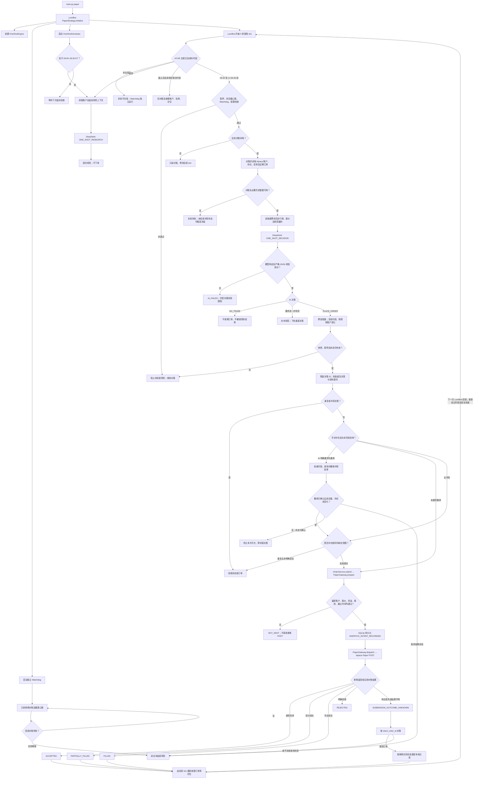

# Alpaca Trade Bot — OneShotEngine

本项目只使用 **OneShotEngine** 作为正式交易决策主引擎。DeepSeek 自主研究市场与账户、决定是否交易、标的、方向、数量、限价以及仓位调整；Python 严格校验并交给 `OrderService`，最后由 `PaperGateway` 向 **Alpaca Paper** 提交。项目不会连接真实交易账户。

当前迁移保持运行账户 `paused=true`、`autopilot=false`。未经用户明确授权，不启动交易或提交 Paper 订单。

## 正式路径

`main.py paper` → LumiBot `PaperStrategy` → `OneShotEngine.tick()` → 结构化 AI 指令 → Python 安全校验 → `OrderService` → `PaperGateway` → Alpaca Paper。

## 当前完整执行流程

以下流程图描述**当前代码的实际行为**，包括独立盘前调度、Watchdog、决策失败及订单对账；它不是未来架构提案。



Watchdog 与交易决策循环相互独立；图中的状态更新不代表立即再次调用 AI。`NO_TRADE` 不对已接受的 DAY 挂单重新评估或撤单。撤单未确认、撤单期间新增成交时，本次平仓会停止；**只有取消结果未知等安全异常才必然触发冻结**。注意当前撤单截止检查仍有“查询券商订单期间跨过 11:59:30”这一待修复竞态，流程图展示的是现状，并不表示该问题已经解决。

`FakeBroker` 只用于离线测试。盘前、盘中和午后使用同一个 OneShotEngine；没有旧 Engine 回退、影子模式、价格触发下单或旧计划二次复核。AI 选择 `NO_TRADE` 时不撤销已接受的 DAY 挂单。部分成交后的仓位由下一次决策评估；平仓前若有冲突挂单，先确认撤单、再核对成交数量和仓位。

## 美东时间

| 阶段 | 时间 |
| --- | --- |
| 盘前准备 | 09:00–09:30 ET |
| AI 交易决策 | 09:30–12:00 ET |
| 新订单与主动撤单截止 | 11:59:30 ET |
| 截止后 | 只读对账和监控；已有 DAY 挂单由券商继续管理 |

NYSE 日历与夏令时由 `market_data.session_info` 处理。11:59:30 ET 起 `can_submit=false`；`PaperGateway` 在最终提交或撤单前再次检查截止时间。

## 安全和数据

每次决策输入包括带时间戳的账户、现金、购买力、持仓成本和盈亏、全部未完成订单及成交量、近期订单和 AI 决策、市场时段、报价与研究档案。缺失或过期的关键券商状态会停止执行。固定股票池、资金、风险、订单合法性、暂停与冻结、去重是 Python 的硬约束。策略配置中的入场和出场文字仅供 AI 参考。

SQLite 保存历史订单、事件和 OneShot 决策 ID。新代码不删除旧数据库表和旧订单历史。故障或网络超时由订单状态机及 Watchdog 对账，未知订单状态冻结新增交易。Dashboard 只读展示 OneShot 决策、账户、订单和研究。

## 本地验证

```powershell
.venv/Scripts/python -m pytest -q
node --check web/app.js
.venv/Scripts/python -m compileall -q src tests
.venv/Scripts/python -m trading_bot.main check
```

`dry-run` 只使用合成账户和 `FakeBroker`，不会发送 Paper 订单。`paper` 是正式交易启动命令；迁移后不要在获得首次实际测试授权前运行。

详细迁移、删除清单、启动验证和数据库兼容说明见 [ONE_SHOT_MIGRATION_REPORT.md](ONE_SHOT_MIGRATION_REPORT.md)。历史考试和旧实现资料归档于 `archive/`，不属于正式交易路径。
